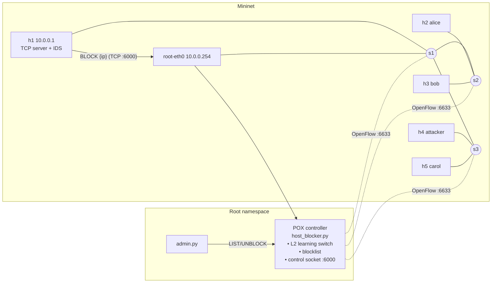

# Dynamic Host Blocking System (DHBS)
**CN Mini Project — SDN + Socket Programming (Jackfruit)**

A multi-client TCP application whose server detects misbehaving hosts
(brute-force logins, connection floods) and asks an SDN controller, over a
TCP control socket, to block them. The controller (POX, OpenFlow 1.0)
instantly installs high-priority DROP rules on **every switch**, isolating
the host network-wide; blocks expire automatically or can be lifted by an
admin.

---

## 1. Problem & objectives (D1: Problem Understanding & Architecture)

Traditional firewalls are configured statically on one box. In an SDN, the
controller has a global view and can push rules to every switch, so the
network itself can quarantine an attacker the moment the *application*
notices abuse.

| Objective | How it is met |
|---|---|
| Low-level TCP sockets, many clients | `app/server.py` – `socket` + one thread per client, capped by a semaphore |
| Application-level protocol | newline-delimited JSON (`app/protocol.py`) with AUTH / ECHO / TIME / STATS / QUIT |
| Detect malicious hosts | sliding-window IDS: ≥3 failed logins / 30 s, or >20 conns / 10 s |
| App → SDN integration | server sends `BLOCK` over TCP to controller's control socket (port 6000) |
| SDN enforcement | POX pushes priority-65000 drop flows (IPv4 + ARP, matched on source IP) to all switches, with hard timeout |
| Recovery | auto-expiry after `block_duration_sec`, or `admin.py unblock` |

## 2. Architecture



**Communication flow when an attack happens**

1. h4 opens TCP connections to h1:5000 and sends wrong passwords.
2. The server's IDS counts failures per source IP in a 30 s window.
3. On the 3rd failure it sends `{"type":"BLOCK","ip":"10.0.0.4",...}` to
   the controller at `10.0.0.254:6000` (the root-namespace interface).
4. POX validates the token, installs `priority=65000, ip, nw_src=10.0.0.4,
   actions=drop` (and the ARP equivalent) on s1, s2, s3, with
   `hard_timeout=60`.
5. All h4 traffic is now dropped at its first switch — even to h5 on the
   same edge switch. Legitimate clients are unaffected.
6. After 60 s the flows expire and the controller clears its table, or an
   admin runs `unblock`.

**Flow table design**

| Priority | Match | Action | Timeout | Installed by |
|---|---|---|---|---|
| 65000 | `ip, nw_src=<blocked>` | drop | hard = block duration | BLOCK |
| 65000 | `arp, arp_spa=<blocked>` | drop | hard = block duration | BLOCK |
| 100 | `in_port, dl_dst` | output:port | idle 30 s | learning switch |
| 0 | table miss | controller | – | default |

## 3. Repository layout

```
app/protocol.py        JSON-line framing, LineReader, request helper
app/server.py          multi-threaded TCP server + IDS + controller reporter
app/client.py          legitimate client (scripted or interactive -i)
app/attacker.py        brute-force / connection-flood simulator
app/admin.py           CLI: list / block / unblock via control socket
controller/host_blocker.py   POX component (switch + blocklist + control socket)
topology/topo.py       Mininet topology + automated D1 test suite (--test)
config/config.json     users, IDS thresholds, controller address, token
scripts/setup.sh       installs Mininet, OVS, POX
scripts/run_controller.sh
results/               events.csv (controller event log) + test output
```

## 4. Setup

Needs Ubuntu 20.04+ (VirtualBox/VMware VM or native install; WSL2 is unreliable
for Open vSwitch).

```bash
git clone <your-repo> dhbs && cd dhbs
bash scripts/setup.sh
```

## 5. Running

**Terminal 1 – controller**
```bash
bash scripts/run_controller.sh
```

**Terminal 2 – automated D1 test run**
```bash
sudo python3 topology/topo.py --test  # exit status 0 only if all checks pass
```

**Or interactive demo** (`sudo python3 topology/topo.py`), then in the Mininet CLI:
```
mininet> pingall
mininet> h1 python3 app/server.py --log /tmp/server.log &
mininet> h2 python3 app/client.py 10.0.0.1 --user alice --password alice123
mininet> h4 python3 app/attacker.py 10.0.0.1 --mode bruteforce
mininet> h4 ping -c 3 10.0.0.1          # fails: blocked
mininet> h5 ping -c 3 10.0.0.1          # works
mininet> sh ovs-ofctl dump-flows s3     # see the drop rule
mininet> h1 python3 app/admin.py list --host 10.0.0.254
mininet> h1 python3 app/admin.py unblock 10.0.0.4 --host 10.0.0.254
mininet> h4 ping -c 3 10.0.0.1          # works again
```
(Run Mininet from the repo directory so the relative `app/` paths work.)

## 6. Test cases (D1)

| ID | Test | Expected |
|---|---|---|
| T1 | `pingall` | 0 % loss – controller's learning switch works |
| T2 | h1 → controller `LIST` via 10.0.0.254:6000 | `status: OK` – app↔SDN channel up |
| T3 | h2, h3, h5 run clients concurrently | all print `SUCCESS` with RTTs |
| T4a | h4 brute-forces | 10.0.0.4 appears in controller blocklist |
| T4b | h4 ping h1 | 100 % loss |
| T4c | h4 ping h5 (same switch s3) | 100 % loss – network-wide isolation |
| T4d | `dump-flows` on s1, s2, s3 | priority-65000 drop rule for 10.0.0.4 on each |
| T5 | h2 client while h4 blocked | `SUCCESS` – no collateral damage |
| T6 | admin unblock, h4 ping h1 | 0 % loss – recovery works |

D1 validation note: syntax checks alone do not prove the Mininet/POX integration
works. Run the test suite in the specified Ubuntu environment and retain the
actual output. The test runner exits with status 1 if any check fails. Malformed
or oversized client messages are rejected and the connection is closed; the
controller response is counted as a successful block only when it returns
`status: OK`.

## 7. Roadmap to D2

- Controller-side detection from flow stats (port scan / SYN flood) independent of the app
- Escalating block durations for repeat offenders; rate-limit (meter/queue) before full block
- Performance: block latency (from `events.csv` vs server log), legit-client RTT/throughput (iperf3) under attack, with vs without DHBS (static L2 switch baseline)
- Challenging scenarios: distributed attackers, controller restart, link failure
