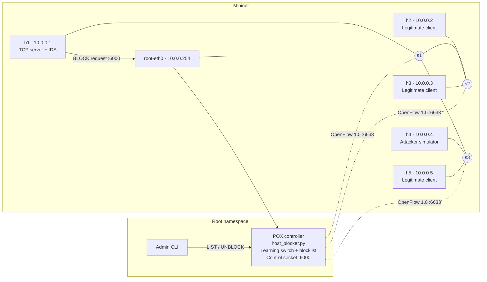

# Dynamic Host Blocking System (DHBS)
**Computer Networks Mini Project — SDN + TCP Socket Programming**

## Demo 2 deliverable

DHBS is a multi-client TCP application integrated with a POX SDN controller. The server detects suspicious hosts through failed-login and connection-rate thresholds. It reports the source IP to the controller, which installs high-priority OpenFlow DROP rules across the Mininet switches.

**Demo 2 retains the complete Demo 1 system** and adds persistent permanent blocking, administrator-only recovery, event logging, flow-table inspection, performance measurement, and robustness validation.

## 1. Features

### Retained from Demo 1

- Multi-client TCP server with bounded client handling.
- Newline-delimited JSON socket protocol: `AUTH`, `ECHO`, `TIME`, `STATS`, and `QUIT`.
- Sliding-window IDS:
  - Brute-force detection: 3 failed logins within 30 seconds.
  - Connection-flood detection: more than 20 connections within 10 seconds.
- Application-to-controller communication over TCP port `6000`.
- POX OpenFlow 1.0 learning-switch behaviour.
- Network-wide IPv4 and ARP source DROP rules.
- Whitelist support.
- Legitimate client, attacker, and admin CLI tools.
- Admin operations to list, manually block, and unblock hosts.

### Added for Demo 2

| Addition | Implementation |
|---|---|
| Explicit DROP-rule enforcement | Priority `65000` IPv4 and ARP DROP rules on every connected switch |
| Detection and response logs | Server log plus timestamped controller `events.csv` |
| Flow-table inspection | `app/flow_monitor.py` displays OVS flow tables for `s1`, `s2`, and `s3` |
| Robustness scenarios | Concurrent clients, brute-force, connection flood, whitelist, controller reconnect/restart and recovery checks |
| Latency measurement | ICMP round-trip average from `app/benchmark.py` |
| Throughput measurement | TCP throughput using `iperf3` |
| Permanent automatic bans | IDS-triggered blocks use duration `0` (no timeout) |
| Admin-authorised recovery | Separate admin token required for `LIST` and `UNBLOCK` |
| Persistent blocklist | `results/blocklist.json` restores active bans after controller restart |

## 2. Architecture



### Detection-to-enforcement sequence

1. An attacker connects to the TCP server on `h1:5000`.
2. The IDS tracks failed authentication attempts and new connections per source IP.
3. When a threshold is crossed, the server logs the detection and sends a `BLOCK` request to the POX control socket.
4. POX validates the application token and installs priority-`65000` DROP rules for IPv4 and ARP traffic sourced from the attacker IP on all connected switches.
5. The controller records the action in `results/events.csv` and persists the blocklist in `results/blocklist.json`.
6. The host remains blocked indefinitely, including after a controller restart.
7. Only an administrator using the separate admin token can issue `UNBLOCK`.

### Flow-table policy

| Priority | Match | Action | Timeout |
|---:|---|---|---|
| 65000 | IPv4 source = blocked host | DROP | Permanent for automatic bans |
| 65000 | ARP source protocol address = blocked host | DROP | Permanent for automatic bans |
| 100 | Learned destination MAC and ingress port | Forward to learned port | Idle 30 seconds |
| 0 | Table miss | OpenFlow default handling | — |

## 3. Repository structure

```text
app/
  protocol.py          JSON-line TCP protocol
  server.py            TCP server, IDS and controller reporter
  client.py            Legitimate TCP client
  attacker.py          Brute-force and connection-flood simulator
  admin.py             Admin-only list, block and unblock CLI
  benchmark.py         ICMP latency and TCP throughput measurement
  flow_monitor.py      Open vSwitch flow-table inspection
controller/
  host_blocker.py      POX learning switch, DROP rules and control socket
config/
  config.json          Server, IDS and controller settings
topology/
  topo.py              Mininet topology and Demo 2 validation suite
scripts/
  setup.sh             Dependency and POX setup
  run_controller.sh    Start POX with event logging and persistent state
results/
  .gitkeep             Runtime logs, metrics and persistent blocklist
```

## 4. Environment and setup

The supplied setup script targets Ubuntu 20.04+ on a VM or native Linux installation. It installs Mininet, Open vSwitch, POX prerequisites, Python and `iperf3`. Run from the project root:

```bash
bash scripts/setup.sh
```

The project uses POX with OpenFlow 1.0. The setup script clones POX into `~/pox` and links the project controller component into its `ext/` directory.

## 5. Configuration

Edit `config/config.json` before running:

- `ids.max_failed_auth`: failed-login threshold (default `3`).
- `ids.failed_auth_window_sec`: failed-login time window (default `30`).
- `ids.max_conn_per_window`: connection threshold (default `20`).
- `ids.conn_window_sec`: connection-rate window (default `10`).
- `ids.block_duration_sec`: `0` means permanent automatic bans.
- `ids.report_cooldown_sec`: suppresses duplicate IDS-to-controller requests for 30 seconds; it does not expire the ban.
- `ids.whitelist`: source IPs excluded from automatic blocking.
- `controller.auth_token`: application-to-controller credential; the app can request blocks only.
- `controller.admin_token`: separate administrator credential for listing and unblocking.
- `controller.state_file`: persistent blocklist path.

**Before using outside a closed lab**, replace the example application passwords and both example tokens. Do not commit real credentials.

## 6. Run the demo

Open separate terminals from the project root.

**Terminal 1 — start POX**

```bash
bash scripts/run_controller.sh
```

**Terminal 2 — start Mininet**

```bash
sudo python3 topology/topo.py
```

**Mininet CLI — start the TCP server and performance endpoint**

```text
mininet> h1 python3 app/server.py --log results/server.log &
mininet> h1 iperf3 -s -D -p 5201
```

**Verify normal client operation**

```text
mininet> h2 python3 app/client.py 10.0.0.1 --user alice --password alice123
mininet> h3 python3 app/client.py 10.0.0.1 --user bob --password bob123
mininet> h5 python3 app/client.py 10.0.0.1 --user carol --password carol123
```

**Measure latency and throughput**

Run from a legitimate Mininet host:

```text
mininet> h2 python3 app/benchmark.py 10.0.0.1 --label baseline
```

The script records average ICMP latency and TCP throughput in `results/performance.csv`. `iperf3` must be installed on the Fedora host before running the automated test (`sudo dnf install iperf3 -y`).

**Simulate brute-force detection**

```text
mininet> h4 python3 app/attacker.py 10.0.0.1 --mode bruteforce
```

**Inspect the flow tables**

```text
mininet> sh python3 app/flow_monitor.py
```

The automated test also saves full snapshots from all three switches to `results/flow_tables.txt`, including a snapshot while the attacker is blocked and another after administrator unblock.

Or inspect one switch directly:

```text
mininet> sh ovs-ofctl -O OpenFlow10 dump-flows s3
```

Look for priority-`65000` rules matching the attacker's source IP with no output action (DROP).

**Inspect the controller blocklist and logs**

```text
mininet> h1 python3 app/admin.py list --host 10.0.0.254
mininet> sh tail -n 20 results/events.csv
mininet> sh tail -n 20 results/server.log
```

**Unblock an attacker (administrator only)**

```text
mininet> h1 python3 app/admin.py unblock 10.0.0.4 --host 10.0.0.254
```

After unblocking, the attacker can communicate again. An application token cannot perform `LIST` or `UNBLOCK`.

## 7. Demo 2 validation scenarios

Run the automated suite from a separate terminal while POX is running:

```bash
sudo python3 topology/topo.py --test
```

| Test | Scenario | Expected result |
|---|---|---|
| T1 | Basic `pingall` | All hosts initially communicate |
| T2 | Server-to-controller control channel | Admin `LIST` request returns `OK` |
| T3 | Concurrent legitimate clients | All clients authenticate and complete ECHO requests |
| T3b | Baseline performance | Latency and throughput are recorded |
| T4 | Brute-force attack | IDS detects h4 and requests a block |
| T4a–T4c | Blocklist and network isolation | h4 cannot reach h1 or h5 |
| T4d | Flow-table validation | DROP rule appears on s1, s2 and s3 |
| T5 | Legitimate traffic during an attack block | h2 remains operational |
| T5b | Performance during attacker block | Legitimate latency and throughput are recorded |
| T6 | Administrator unblock | h4 connectivity is restored |
| T7 | Connection-flood attack | Connection-rate IDS detects and blocks h4 |
| T7b | Permanent-ban validation | Blocklist entry has no expiry (`until: null`) |
| T8 | Event logging | Server and controller logs are present |
| T9 | Admin recovery | Authorised admin unblocks h4 and connectivity returns |
| T10 | Flow-table report | Full flow tables for s1, s2 and s3 are saved in `results/flow_tables.txt`; the blocked-phase snapshot contains the attacker's priority-65000 DROP rule |

### Additional robustness checks for the live demonstration

- **Controller restart:** restart POX while Mininet is active; confirm that the blocklist is restored from `results/blocklist.json` and DROP rules are applied when switches reconnect.
- **Switch reconnect:** disconnect and reconnect a switch; confirm that active block entries are re-applied.
- **Unauthorised recovery:** attempt `UNBLOCK` with the application token; the controller must reject it.
- **Whitelist:** trigger a detection condition from a whitelisted address in a controlled test; it must be logged but not automatically blocked.
- **Legitimate traffic:** verify that non-blocked clients continue to authenticate and exchange data while the attacker is isolated.

The automated suite covers the main traffic, detection, flow, performance and recovery path. The additional robustness checks above are live/manual checks and should only be reported as passed after they have actually been run.

## 8. Output files

| File | Purpose |
|---|---|
| `results/server.log` | IDS detections and application responses |
| `results/events.csv` | Timestamped controller events: block, unblock, expiry and rejected control requests |
| `results/blocklist.json` | Persistent active blocklist |
| `results/performance.csv` | Latency and throughput measurements |

Runtime result files are generated during execution and are not pre-populated with fabricated measurements.
